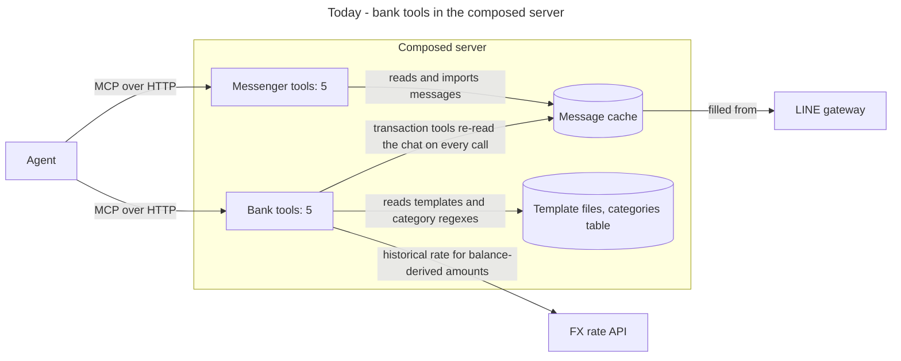
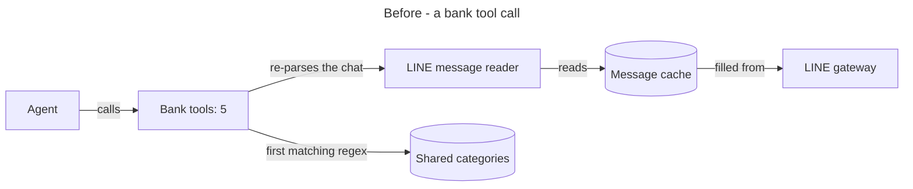
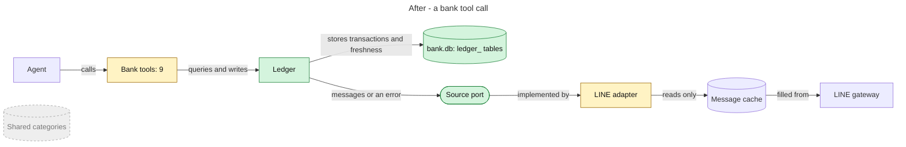
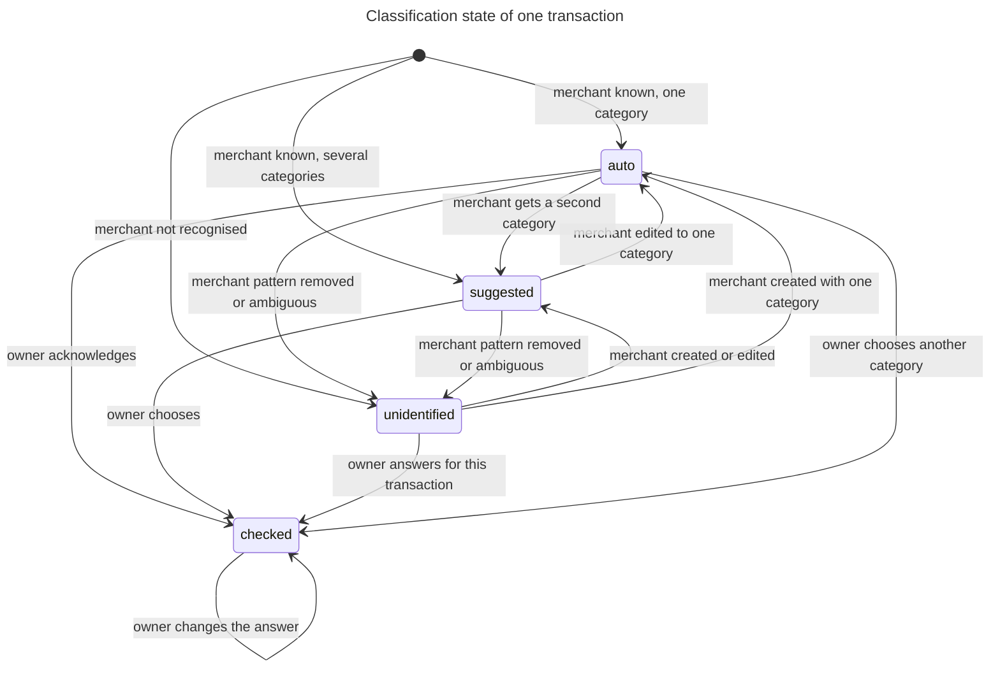

# RFC: Replace the stateless bank parser with a persisted expense ledger

| Field | Value |
|---|---|
| Status | In review |
| Author | RaidenYN-Shadow |
| Decider | RaidenYN |
| Review by | RaidenYN; no date set, the feature is not scheduled for implementation |
| Created / Updated | 2026-11-20 / 2026-11-24 |
| Links | None. The session analysis and the earlier draft are working files outside the repository |

Reading order: [Summary](#summary) and [What changes](#what-changes) (2 min) · add [How it works today](#how-it-works-today), [Proposal](#proposal), [Contracts](#contracts), [Milestones](#milestones), [Drawbacks and risks](#drawbacks-and-risks) (10 min) · [Decisions to approve](#decisions-to-approve) last.

This RFC is the source of truth for the feature. Decision records and task breakdowns are written from it. An earlier draft exists outside the repository; nothing in it is binding.

## Summary

`packages/bank-mcp` becomes a persisted, per-owner ledger: the server stores each transaction once, keeps the owner's decisions about it, and computes every reported number itself. Today it stores bank messages and category regexes but rebuilds every transaction from them on each call, so the agent that produces daily and weekly expense reports had to keep its own ledger and gave the owner two different values for one charge. The result is four milestones: three build the server and end with nine bank tools, three of today's five removed; the fourth delivers the agent skills for them. Every decision is agreed; the RFC waits for the decider's acceptance. Five unverified assumptions are listed as open questions.

## Problem and context

The server stores LINE messages and a shared table of category regexes, and rebuilds every transaction from them on each call. Three things follow. A transaction has no identity that a decision could attach to. The only way to record "this purchase is groceries" is to edit a regex that every transaction shares. Nothing records what has already been reported or asked.

The evidence is one reviewed agent session of 442 messages, 16–19 November 2026 (measured in the author's analysis of that session, which is not in the repository):

- The agent issued 58 `manage_categories` calls, each re-sending a whole regex, and classified some transfers by amount inside a regex.
- It reported one foreign-currency charge as about 3,600 THB in one report and about 2,140 THB in another an hour later, because it converted on its own side with two methods.
- It counted a card-bill payment in addition to the card purchases, overstating the period's spending by roughly 40%.
- It asked three already answered questions again on three consecutive days.

The owner wants daily and weekly reports, and answers such as "how much did I spend on my last trip?", without the agent doing arithmetic. Why now: in that session the agent built a private ledger in CSV files and scripts around the server.

## How it works today

The bank side is a stateless parser inside the composed server. The context diagram shows the parts this feature touches.

Legend: boxes are components, cylinders are stores, arrows are labelled with how the source uses the target.

- **Tools.** `get_transactions`, `summarize_transactions`, `manage_categories`, `manage_templates` and `sample_messages` (`packages/bank-mcp/src/tools/`). All return MCP text content, sometimes containing serialised JSON; none returns structured content.
- **Parsing.** `parseTransaction` in `packages/bank-mcp/src/transaction-parser.ts` applies per-chat templates; `tools/fetch-transactions.ts` picks the templates valid at a message's time.
- **Categories.** One shared table `categories(id, name, pattern)` in `bank/bank.db`, read through `category-store.ts`. The first matching regex wins, in insertion order.
- **Messages.** The LINE message cache (`packages/line-client-sqlite`, table `messages`) keeps fetched and imported messages. It is filled by `packages/line-mcp/src/sync.ts`, by tool calls and by export import. The bank tools read it through a per-principal reader (`tools/deps.ts`).
- **FX.** The server converts only inside `applyBalanceDiffs` (`transaction-parser.ts`), for a message that carries no account-currency amount and whose original currency differs from the account's. It multiplies the original amount by a historical rate fetched through `fx-rates.ts` and held in process memory, and uses the balance difference as a cross-check or, without a rate, as a fallback. Nothing converts a transaction to one base currency.

Prior art: `summarize_transactions` totals a period but has no identity, base currency or stored decisions. Earlier designs in `docs/superpowers/specs/` each extended the stateless parser.

## Goals and non-goals

**Goals**

- Reads are repeatable: the same query for the same time range returns the same data as long as the owner changed nothing, LINE returns the same messages and no template of the source was edited. A changed message or template moves the facts of open transactions only; a checked one changes only when the owner accepts a correction. It can, however, put a checked transaction on the "needs review" list with a proposed correction, or take it off again, which changes the daily report and its summary but no figure that is not filtered by "needs review". One exception: a transaction stored without an exchange rate is valued when the rate arrives. Baseline: one charge reported with two different THB values (measured).
- A checked transaction never changes on its own: neither its classification nor its amount and date. Only the owner changes it. The late valuation named above is the one exception: it fills in a missing base amount.
- The server does not ask again about a transaction or merchant the owner has answered. Baseline: three questions repeated on three days.
- Money moved between the owner's own accounts is not counted as income or spending. Baseline: spending overstated by roughly 40%.
- A transaction the ledger has stored stays. When a source cannot be fetched, every answer that returns or totals transactions says that the list may be incomplete because of the LINE error.
- The agent computes no totals, shares, averages or conversions.
- Counter-metric: the messenger tools, OAuth and the LINE message cache behave as before.

**Non-goals**

- Migrating existing categories.
- Detecting refunds automatically, and partial refunds. Thai banks do not announce refunds in LINE; the owner marks a full refund by hand.
- The postponed features listed in [Appendix F](#f-postponed-features), among them manual transactions, bulk changes of the classification of checked transactions and agent rules.
- Doing the agent's work on the server: web search, the conversation with the owner, scheduling, report wording and delivery stay with the agent and its harness. The skills that tell the agent how to do this work with the new tools are part of this project, as its last milestone (M4).

## What changes

| Component | Today | Proposed | Change | Decision / milestone |
|---|---|---|---|---|
| Ledger | None | Transactions stored once with stable identity | NEW | Checked-is-final / M1 |
| Source port | Tools call a LINE reader | The ledger reads messages through a port | NEW | Source port / M1 |
| LINE read (`line-client` code) | Returns messages; failures are not typed for the bank tools | Returns a list of messages or a typed error | CHANGED | Transaction-level consistency / M1 |
| LINE message cache (database) | Stores fetched and imported messages | Same schema; the ledger only reads it | UNCHANGED | Cache-untouched |
| Ingest record and freshness | None | In the ledger database: the messages ingested, and per source the last successful fetch and the last error | NEW | Transaction-level consistency / M1 |
| Changed facts | Every call re-parses, so any template edit silently changes every past amount | An open transaction takes new facts; a checked one keeps its facts and gets a proposed correction for the owner | NEW | Corrections need the owner / M2 |
| Template writes | Saved at once; the first matching template reads a message | Checked first against the writer's recorded messages: overlaps block the write, examples of newly read messages and changed transactions are shown | CHANGED | Template rescan / M1 |
| Currency conversion | Only for amounts derived from balances, at a rate held in memory, with the balance difference as fallback | Every transaction valued in one base currency at a stored rate; the balance difference is a cross-check only | CHANGED | Balance amounts / M1 |
| Internal transfers, reversals | Every row is income or spending | Kept out of the totals through a merchant mapping, a template hint or the owner's mark | NEW | Internal transfer by merchant / M2 |
| Analytics | `summarize_transactions` | `analyze_transactions` returns figures; rows come from `list_transactions` with the same filters | NEW | One analytics tool / M3 |
| Classification | Shared regex table, first match wins | Merchants with their possible categories; a checked transaction keeps its category | CHANGED | Merchant-first / M2 |
| Owner marks | None | Refunded, internal transfer, category for one transaction | NEW | Manual refund mark / M2 |
| Daily report | Rebuilt by the agent from scratch | One list request: the transactions that need review (open ones, categorised automatically or not, and checked ones with a proposed correction), with a summary by category; one write acknowledges and answers them. No report state on the server | NEW | No report state / M2 |
| Tags, sub-accounts | None | General tags such as a trip, "Christmas 2026" or "AI"; cards under an account | NEW | M1 (sub-accounts), M2 (tags) |
| `get_transactions`, `summarize_transactions`, old `manage_categories` | Present | Removed without alias; `manage_categories` returns in M2 with a new per-owner contract | REMOVED | Single release / M1 |
| Tool results | Text content, sometimes serialised JSON | Structured, typed errors, bounded | CHANGED | Tool envelope / M1, M2 |
| Legacy `categories` table | Read by the tools | Left in place, unread | UNCHANGED | No-migration |
| Messenger tools, OAuth, `line-mcp` sync | | Same behaviour | UNCHANGED | |

Before and after, as the same diagram:

Legend: green is NEW, yellow is CHANGED, dashed grey is no longer read by the bank tools.

## Proposal

The server keeps a ledger of transactions built from bank messages and answers every bank tool from it. A tool call asks each source for new messages, adds what arrived to the ledger, and answers from the stored data.

### Server and agent

The server owns data and numbers. The agent owns everything said to the owner.

| Server (this repository) | Agent (its harness; skills from M4) |
|---|---|
| Transactions, their identity and amounts | Web search for a merchant the server could not identify |
| Stored decisions, merchants, tags, accounts | Asking the owner and wording the question |
| All arithmetic: totals, shares, conversion | Scheduling daily and weekly runs |
| Which transactions need review | Report wording and delivery |

### What is stored and what changes

A transaction has two parts with different rules.

**Facts** come from the bank message through a template: amount, currency, date, direction, account and the merchant code as the bank wrote it. They are read again when the message changes in the cache or when a template of that source is edited. For an open transaction the new facts replace the old ones, and the change is logged with the old and new values. For a checked transaction nothing changes: the new facts are stored next to it as a **proposed correction**, and the owner accepts or rejects it ([Corrections and template changes](#corrections-and-template-changes)).

**Classification** is the merchant, the category and the marks (internal transfer, reversal, refunded). Once a transaction is **checked**, its classification is stored on it and nothing but the owner changes it: no merchant edit, and no accepted correction of its facts. The server keeps a trace of what set each classification, for debugging and analytics; the trace does not drive anything.

**Money.** The owner's base currency is set once, with the first source, and cannot be changed in this RFC. The base amount of a transaction is worked out from its facts and stored with the rate used; it is worked out again only when those facts change, which for a checked transaction means only when the owner accepts a correction. When the currency is unknown or no rate is available, the transaction is stored without a base amount, and the rate is filled in later if it becomes available. That late valuation is logged, and it is the one case where a figure, also that of a checked transaction, changes although neither the owner, LINE nor a template changed anything; every result therefore carries the count of unvalued transactions and their totals per original currency.

Today's parser also uses the difference between two balances (`applyBalanceDiffs`). When a message gives only a foreign amount, it converts by exchange rate and uses the balance difference in two ways: as a cross-check, flagging the transaction when the two disagree by a wide margin, and as the amount itself when no rate is available. The ledger keeps the cross-check and drops the fallback: without a rate a transaction has no base amount and is reported as unvalued. The cross-check is done once, when the transaction is first stored, against the balance of the transaction just before it on the same account, and only for a transaction that is the newest of its account at that moment. One that turns up out of order, such as a January purchase found after March was stored, has no trustworthy neighbour and is not cross-checked.

Agreed, **Balance amounts**: exchange rates come from a rate provider, as today (`fx-rates.ts`, frankfurter.dev), and are stored; the balance difference is a cross-check only and never the amount. A converted amount is an estimate at the provider's daily rate, not the bank's own rate and fees, and is marked as converted on the row. A fallback amount was rejected because it can be wrong in a lasting way: a balance difference is the sum of everything between two stored balances, so one missing message makes it wrong, and no tool corrects an amount. Whether one provider covers the owner's currencies is not checked (open question FX coverage); a second provider is a small addition behind the same lookup.

A **refresh** is one fetch followed by the compare step ([Appendix B](#b-ingest-and-freshness-rules)). All changes of one refresh are written in one database transaction, so a tool call never sees a half-updated ledger.

Agreed, **Checked-is-final** and **Publish-whole** (with the condition that the classification of checked transactions is not recomputed): this is what makes reads repeatable. Checked-is-final covers the whole transaction, facts included.

### Corrections and template changes

Agreed, **Corrections need the owner**: a checked transaction keeps its facts until the owner approves a change. When a re-read gives other facts, the transaction gets a **proposed correction**: it stays checked but **needs review** again, so the daily report lists it with the old and new values; the figures keep the stored facts, and the owner accepts or rejects it. A proposal always reflects the latest read: a later read with other facts replaces it, and one that gives the stored facts again withdraws it. An open transaction takes new facts at once. A template edit by another user of the server reaches this owner in the same form.

Agreed, **Template rescan**: a template write is checked against every message the writer's own ledger has recorded for the source before it is saved, and the agent sees the result first. Another owner's messages are never read for it and never shown, so an overlap that exists only in another owner's history does not block the write; there the first matching template in saved order reads the message, as today (`transaction-parser.ts`). If that changes which template reads a message, the usual rule applies in that owner's ledger: an open transaction takes the new facts and a checked one gets a proposed correction. The result has three parts:

- **overlaps**: two active templates must not read the same message. If the new one is meant to take over, the old one is deactivated;
- **newly read messages**: a few examples with the original text and the parsed values, so the agent can confirm the template works. A stored transaction is never deleted, so a wrong template must be caught before it is saved;
- **changed transactions**: the old and new facts, which become changes of open transactions and proposed corrections of checked ones.

Agreed, **New template for a new format**: when the bank changes the format of its messages, the agent adds a new template valid from the date of the change (`valid_from`, which templates have today) and leaves the old one alone. Editing a template is for repairing a mistake in it. The tool's description and its responses say so.

The mechanics are left to the M1 and M2 breakdowns: how a write is confirmed, the fields of the result, how corrections are identified, accepted in bulk and kept from being raised twice.

### Classification

Classification follows the merchant, in three outcomes rather than rule modes:

| The message's merchant code | Result | State |
|---|---|---|
| Matches a known merchant that has one category | The category is applied | `auto` |
| Matches a known merchant that has several categories | The owner chooses among them for this transaction | `suggested` |
| Matches no merchant, or more than one | The merchant must be identified | `unidentified` |

A fourth state, `checked`, is reached only through the owner: by choosing a category, or by acknowledging an `auto` one. A transaction that is not checked is **open**.

A merchant record holds a name, the patterns that recognise its codes, and its possible categories. For `Grab_1234` with no match, the agent searches and proposes "Grab"; the owner then gives the categories Grab can fall into (Taxi, Delivery, Food) and the category of this transaction. The server stores the merchant, its pattern, its categories and that one answer. A message with no merchant code, such as a transfer without a payee, is answered by the owner directly for that transaction.

A new or edited merchant is applied to every open transaction and to none that is checked. That is what makes review light: the owner sees the whole list with a category already on most rows and acknowledges it in one answer.

Agreed, **Acknowledge to check**: an automatically applied category counts in the figures at once, but the transaction becomes checked only when the owner acknowledges it. One call acknowledges any number of transactions (**Bulk confirm**).

Agreed, **Merchant-first**: these three outcomes replace per-rule `auto` or `suggest` modes, rule priority and Rule-conflict asks. A merchant's patterns match the merchant code only, not the rest of the message. Cases a merchant code cannot decide, such as a transfer without a payee or an aggregator, are answered by the owner per transaction; rules for them are a postponed feature ([Appendix F](#f-postponed-features)).

### Internal transfers, reversals and refunds

A bank transfer is an ordinary transaction. Three things are not income or spending and are kept out of the totals:

- an **internal transfer**: money moved between the owner's own accounts, for example the bank debit that pays the card bill;
- a **reversal**: a message in which the bank reports a charge as cancelled;
- a **refunded** purchase.

Agreed, **Internal transfer by merchant**: a transaction becomes an internal transfer the same way it gets any category, through its merchant or the owner's answer. It is then excluded from analytics whether the transfer shows on one side or on both. UOB does not report a card-bill payment, so only the SCB debit exists; mapping that debit's merchant to "internal transfer" handles every month, provided the message carries a merchant code; otherwise the owner marks each one. Pairing the two sides of a transfer automatically is out of scope.

Agreed, **Internal-transfer-shape**: "internal transfer" is a built-in category that exists for every owner and cannot be deleted. Merchants map to it like to any category, and a transaction in it has no other category. Every transaction also carries a read-only field `counts_in_totals`, which is false for internal transfers, reversals and refunded transactions, so an agent can explain a total without knowing category names. A tag was rejected because tags are optional, many per transaction, and filter rather than exclude; a separate flag because it would need its own mapping.

A reversal is recognised by a hint on the template that parses the cancellation message. The cancelled charge itself is marked by the owner.

Agreed, **Manual refund mark**: the owner marks an existing transaction as refunded, in full. It leaves the spending of its category and is listed separately.

### Consistency and the LINE cache

Agreed, **Cache-untouched**: the LINE message cache keeps its schema and the ledger only reads it. The ledger's own data is in `bank/bank.db`.

Agreed, **Transaction-level consistency**: the guarantee is about transactions, not about fetches. The LINE client returns a list of messages or an error. Every transaction built from a returned message is confirmed and stays. A failed fetch brings no new messages from LINE; whatever is already in the cache, such as an imported export, is still ingested. Answers that return or total transactions (`list_transactions`, `analyze_transactions`) then carry an error saying that the transaction list may be incomplete because LINE could not be read, with the time of the last successful fetch. Other tools are not affected.

A gap in history is closed by asking again: the owner or agent can request the messages of any time range. Transactions already stored keep their identity and the owner's decisions; a message not seen before becomes a new transaction that is open for the owner's review and is never checked automatically. The rules are in [Appendix B](#b-ingest-and-freshness-rules).

On each refresh the ledger reads the source's cached messages and compares them with its record of ingested messages: a new message becomes a transaction, a changed one is re-read. The ledger runs its own hourly timer; the `line-mcp` sync is unchanged. Older history comes from a chat export imported with the existing messenger tools, and is ingested the same way.

### Analytics and reports

One tool, `analyze_transactions`, answers every numeric question: totals by time bucket, category, source, account, card, merchant, currency or tag, with shares and averages. The weekly report and every question about a period use it. The daily report's list carries its own summary by category, computed by the same code, and is complete from M2. `analyze_transactions` returns figures only, never transactions. To see the rows behind a figure, the agent makes a separate `list_transactions` request with the same filters and the period it wants: this period, the previous one, or both. That is how the owner checks a category that looks wrong.

Any filter combines with any breakdown: the Car&Bike category by month, or everything tagged "AI" by quarter, is one request each, and the row of buckets is itself the comparison over time. A time bucket is a day, week, month, quarter or year.

Two extra comparison figures exist. With no time breakdown, each group carries its figure for the previous period. For a period that has not ended, such as this month so far, the tool also returns one standalone number: the total for the same number of days at the start of the previous period.

A tag is any label the owner defines: a trip, "Christmas 2026", "AI". A transaction can carry several tags, so the totals of different tags may overlap and need not add up to the overall total. Tags are applied by the owner or the agent, never automatically. One request tags every transaction that matches a filter, for example all JPY transactions of last month, so a bulk request is one call.

Agreed, **Analytics-limits**: the extra previous-period figure is not added to a time breakdown, where the neighbouring bucket already gives it; analytics returns no transaction lists; there is no automatic tagging. Tagging by filter is the bulk path.

Agreed, **Milestone order**: classification and tags are built before analytics, because analytics rests on all the other features. Tags therefore exist when the first trip question is asked.

Uncategorised transactions are their own group in every result and their own filter value in `list_transactions`, so the agent can list them directly. When a result is capped, for example to the twenty largest merchants, the remainder is summed as "other". Figures are not paged: the agent raises the group limit or narrows the filter. `list_transactions` accepts a list of merchants, so the rows of any set of merchants come back in one filtered request.

### On-boarding and the daily report

Neither is a process on the server. Both are list requests the agent makes, on whatever schedule its harness runs.

**The daily report** is the list of transactions that need review: the open ones, and checked ones with a proposed correction. It has four steps:

1. The agent asks `list_transactions` for the transactions that need review and their summary by category. The list holds the `auto` transactions with their categories, the ones still without a category, and any proposed corrections.
2. The agent talks with the owner about those without a category and about the corrections only.
3. The agent writes the result back in one call: the owner's categories, the decisions on corrections, and the acknowledgement token of each page it showed.
4. The agent asks for the same time span again, now regardless of state, and shows the final list and summary.

On a good day every row is `auto`: the owner sees the list and the summary in step 1 and only acknowledges.

No position is needed, because needing review is a property of each transaction. Whatever the interval, every transaction that still needs review appears in the next request: a skipped day makes the list longer, and if an acknowledgement is never written, those transactions appear again next time, recognisable by their timestamps. Nothing that needs review is ever skipped. The list is not frozen between requests: a new message adds a row, and a later re-read can withdraw a proposed correction, which takes that checked row off the list with its facts unchanged. Three details make this safe:

- **The acknowledgement covers exactly what was shown.** Each page of the "needs review" list comes with an acknowledgement token. The token is not stored on the server; it encodes the filter, the first and last row of the page, and a fingerprint of the `auto` rows on it with everything the acknowledgement freezes: all their facts, the merchant, the category and the marks. A transaction that arrived during the chat is outside every token. If a merchant edit changed a shown category in the meantime, or a re-read changed a shown amount, the fingerprint no longer matches. The whole write is then refused, naming the stale page; nothing is saved, and the agent reads that page again and repeats the write.
- **It never invents a category.** A transaction without a category stays open even inside the acknowledged range, and the answer says how many remain.
- **Each row shows two times:** when the transaction happened and when the ledger first saw it.

**Where the list begins.** Each source has a setting, `review_from`, a date. Transactions dated before it are stored and counted in analytics but are not on the "needs review" list, with one exception: a transaction found later by a re-request of a time range is listed whatever its date, because the owner asked for that range. A checked transaction with a proposed correction is in the daily report whatever its date. On-boarding sets it, by default to three months back, or to the start of the imported history when that is shorter. On-boarding itself is the same four steps over that longer list, to collect merchants and categories.

Agreed, **No report state**: the server keeps no report position, review time or schedule. A proposed correction is not report state either: it belongs to its transaction and puts it in the daily report's list. The facts of open transactions can still change without the owner; `list_transactions` returns a transaction's log entries on request and can filter for transactions changed since a date, so the agent can explain a total that moved.

### Identity

A transaction has its own id and is tied to its bank message. When LINE later serves a message that was first imported from an export, the cache replaces the imported row under a new id. The ledger carries the transaction and its decisions over only when the match is unambiguous: one imported row gone, one fetched row new, equal text in the same minute, and nothing else with that text in that minute ([Appendix B](#b-ingest-and-freshness-rules)).

Agreed, **Duplicate-after-restore**: when that match is ambiguous, for example two identical messages in one minute or a cache restored from a backup, the ledger keeps both transactions and flags them as possible duplicates. Nothing is merged automatically, and neither is treated as a duplicate until the owner decides.

Agreed, **Duplicate-mark**: confirming a duplicate marks the transaction and never deletes it. The owner may mark any transaction as a duplicate of another, flagged or not, and names both. The other one must be a different transaction of the same owner that is not itself marked as a duplicate, and a transaction that others point to cannot be marked until they are re-pointed or unmarked, so at least one of a group is never marked as a duplicate. Whether that one counts in the totals still depends on its own category and marks. A marked duplicate points to the transaction it duplicates, has `counts_in_totals: false`, is hidden from lists unless asked for, and can be unmarked. One exception: a marked duplicate with a proposed correction is on the "needs review" list like any other checked transaction, so a pending correction is never hidden. An open transaction that is marked as a duplicate does not need review while it is marked: the mark is the owner's answer for it. If it is unmarked, it needs review again like any open transaction. Deleting is not possible with an untouched cache: the message is still there, so the next compare would ingest it again as new.

Agreed, **Templates stay shared**: LINE templates remain shared per chat, as today. The rule for another kind of source is decided when one is built ([Appendix F](#f-postponed-features)). How templates are stored and presented may still change so that they fit the new design, for example the merchant code, the time zone and the reversal hint; that format is left to the M1 breakdown.

Checked in the code (`packages/line-client-sqlite/src/sqlite-message-cache.ts`, `packages/line-mcp/src/import-service.ts`, `packages/line-client/src/export-parser.ts`): an imported export is stored under the same chat id as the fetched messages, so one source id covers both. Imported rows get an id `export-<hash>` and a time rounded to the minute, computed from the timezone given at import. The cache already replaces an imported row when a fetched message has the same text in the same minute, which is the rule the ledger follows. One weakness follows: an export imported with the wrong timezone is shifted by whole hours, matches nothing, and leaves every overlapping message twice.

Agreed, **No wrong-timezone handling**: the ledger does not detect this. The agent always asks the owner for the timezone of the dates in an export before importing it. If a wrong timezone is given anyway, the owner removes the result with Duplicate-mark.

Routine: `ledger_` tables live in the existing `bank/bank.db` (`docs/ARCHITECTURE.md`). Nothing under `bank-mcp/src/ledger/` imports `line-client`; `tests/architecture/import-boundaries.test.ts` checks package-level imports today, so this finer rule is new work in M1.

## Contracts

Each contract is additive while milestones land: new tables, fields, members and values only.

### Source port

- **What it is:** interface between the ledger and a message source.
- **Shape:** `catchUp(source, deadlineMs)` fetches from the last successful catch-up to now; `fetchRange(source, sinceMs, untilMs, deadlineMs)` fetches a requested stretch of history; both return messages or a typed error (`session_expired`, `unavailable`). `read(source, range)` returns stored messages `{ id, createdAtMs, text, imported }`. A source is identified by immutable `provider`, `native_id` and `source_id`.
- **Produced by:** M1. **Consumed by:** M2–M3.
- **Stability:** identity frozen; further members provisional until a second provider exists.
- **Agreed:** for LINE, `source_id` is the chat MID, so template files keep working. Alternative: hashed ids everywhere. Changing it rewrites every ledger row.

### Ledger data model

- **What it is:** data model, outlined in [Appendix D](#d-data-model-outline).
- **Shape:** every row is owner-scoped; amounts are integers in the currency's minor unit; a transaction row holds its facts, its classification and its state; nothing the owner decided is ever deleted by a refresh.
- **Produced by:** M1. **Consumed by:** M2–M3, each adding tables.
- **Stability:** frozen once M1 ships, because it holds user data.
- **Agreed:** classification is stored on the transaction, not derived from rules. Alternative: derive it on read. Changing it needs a data migration.

### Tool envelope

- **What it is:** error model for all bank tools.
- **Shape:** structured result; errors `{ code, message, action?, details? }` with codes `setup_required`, `invalid_argument`, `not_found`, `conflict`, `internal_error`, `line_session_expired`; `idempotency_key` and `expected_revision` on writes; lists are ordered by the ledger's ingest sequence number (a request may ask for transaction-date order instead), and a cursor continues after the last row returned, so in ingest order a row is never repeated and a change in the ledger does not invalidate the cursor. In transaction-date order that is not guaranteed: a row whose date changes between two pages can appear twice or be missed.
- **Produced by:** M1. **Consumed by:** M2–M4.
- **Stability:** frozen.
- **Agreed:** the cursor is enough; a list is not refused because the ledger changed while paging. A transaction that appears behind the cursor during paging is missed by that pass and seen by the next. Totals are not affected, because figures come from one `analyze_transactions` request.

### Filter set

- **What it is:** interface shared by lists, bulk tagging and figures.
- **Shape:** period (preset or dates, in the owner's timezone), sources, accounts and cards, categories including the value "uncategorised", state (`auto`, `suggested`, `unidentified`, `checked`, or "open" for the first three), "needs review" as a separate filter (defined in Appendix A), changed since a date, a list of merchants, tags, currency, direction, amount range, `counts_in_totals`.
- **Produced by:** M1 (`list_transactions`). **Consumed by:** M2 (tagging by filter, review), M3 (`analyze_transactions`), M4 (the skills name the filters).
- **Stability:** provisional until M3 is tested on real data; values are added, not renamed.
- **Agreed:** one filter set for all three uses, so the rows behind a figure are always reachable by repeating its filters. The daily report asks for "needs review", which also returns checked transactions with a proposed correction; a figure for state "open" covers every open transaction, also those older than `review_from`, and none that is checked, and a list with the same filters returns exactly those rows. Alternative: a separate reference from a figure to its rows. Changing it later is additive.

### Left to implementation

The exact request and result of `analyze_transactions` (its measures and bounds are in [Appendix C](#c-tools)), order of suggested categories, merchant-code normalisation, FX provider choice, guide and prompt wording, index design, list bounds, the hourly timer's interval setting, and how the compare step is made cheaper if it proves slow.

Also left to the breakdown of the milestone that owns it, because no other milestone depends on the answer: the mechanics of template writes and corrections (M1, M2), and the storage format of templates (M1; formerly the open question Template shape). The RFC fixes only what crosses milestones: templates stay shared per chat, and after a format change the previous release must still be able to read them.

Left to the M4 breakdown, at the owner's direction: how the skills are distributed so that they stay in sync with the server.

## Alternatives

| Criterion | Proposed ledger | Stateless parser plus an override table | Do nothing: the agent keeps the state |
|---|---|---|---|
| Same numbers twice | Yes | No: conversion and totals stay per call | No (measured) |
| Decisions stored once | Yes | Per transaction only | In agent files, which drifted |
| "What is new" without agent memory | Yes | No | No (measured) |
| Build cost | Four milestones | One milestone | None |
| Breaking change | Yes, one release | No | No |

The deciding trade-off is build cost against repeatable numbers. The override table is the strongest runner-up: it is small and fixes one-off classification. It lost because it leaves the three measured failures in place: differing values, double-counted card payments and repeated questions.

### Abandoned ideas

- Recomputing classification from rules on every change: checked transactions must not change on their own.
- Per-rule `auto` or `suggest` modes, rule priority, Rule-conflict asks and patterns on the whole message text: replaced by Merchant-first.
- Pairing the two sides of a transfer automatically (Auto-pairing, Pairing-rule), and never excluding without the owner (No-silent-exclusion): out of scope; a merchant mapping does the job.
- A checked range per source with `confirmed`, `accepted` and `unverified` labels, fetch outcomes and export acceptance: replaced by Transaction-level consistency.
- Partial refunds: later.
- Coverage tables, a change journal and resumable fetch state inside the LINE cache, and a separate RFC for them (Split-fetch): superseded by Cache-untouched.
- Storing the agent's search candidates: the server stores the confirmed merchant only.
- A tag kind `trip`: tags are general.
- A configurable week start: the owner fixed Saturday to Friday.
- Refusing the next page of a list when the ledger changed: a stable cursor is enough.
- Flagging possible duplicates from an export imported with the wrong timezone (Import-time flag): not worth the complexity.
- A `drill` reference from a figure to its rows: the agent lists by the same filters instead.
- A separate `manage_labels` tool and a breaking step at analytics (Breaking-at-M3): replaced by Single release.
- Paging through analytics groups: a group limit with an "other" remainder instead.
- Automatic tagging by a tag's dates and conditions: postponed; tagging by filter covers the bulk case.
- An event feed with reader positions, acknowledgement and totals pages, then a review time on each transaction, a moving review position per source and a `review_transactions` tool: the daily report is a list request and the server keeps no report state. The fixed cutoff `review_from` is kept (Review start); it is a setting, not a position.

## Drawbacks and risks

- **Breaking release (hard to reverse).** The whole feature ships as one release that removes three old tools; agents that name them must be rewritten; M4 delivers the skills for that. Between M1 and M3 the main branch has no totals tool, which is acceptable only because nothing is released in between.
- **Empty taxonomy (hard to reverse for the owner's time).** Categories are not migrated, so the owner classifies again.
- **Silent gaps in history.** The ledger does not know whether LINE returned every message of a period. Mitigation: an explicit error when a fetch fails, a re-request of any time range, and an export for history LINE no longer serves.
- **Review load.** On-boarding months of history means reviewing every transaction once. Mitigation: merchants pre-fill the suggestions and one call confirms a list.
- **Converted amounts are estimates.** A foreign purchase is valued at the provider's daily rate, not the bank's rate and fees, so it differs from the amount on the statement. A currency the provider does not cover stays unvalued and is reported as such.
- **Correction load after a template repair.** Repairing a template can propose a correction for every checked transaction it read, and another user's edit of a shared template can do the same. Mitigation: the rescan shows the count before the write is saved, and one call decides any number of corrections.
- **A wrong amount on a checked transaction stays** until a template repair proposes the right one and the owner accepts it; there is no manual amount.
- **Stale categories by design.** A checked transaction keeps its category when its merchant's categories change. That is the agreed behaviour, and the owner corrects it by hand.

## Cross-cutting concerns

- **Security and privacy:** every ledger table and lookup is owner-scoped, and another owner's id is `not_found`. Templates are the one exception: they stay shared per chat, so another trusted user of this server who follows the same bank can edit a template and thereby change how this owner's messages are read. That changes this owner's open transactions and proposes corrections to the checked ones; it never changes a checked transaction. Raw message text is returned only on request and truncated.
- **Failure behaviour:** when LINE cannot be reached, tools answer from the stored ledger; those that return or total transactions add the incomplete-list error.
- **Observability:** `ledger_status` reports the last successful catch-up, the last error, and per source the number of transactions that need review.
- **Migration and rollback:** new tables only; the cache and the legacy `categories` table are untouched, so rolling back to the previous release restores the old tools with their data. If the template format changes (left to the M1 breakdown), the old release must still be able to read the files, or an old-format copy is kept. Decisions made in the ledger stay in its tables, unused.
- **Cost:** no new service or dependency. The owner spends time on on-boarding; the agent's skills are written in M4; the schedule prompts stay in the agent's harness.

## Milestones

| Milestone | Outcome (what works when done) | Produces | Consumes | Depends on | Size | Status |
|---|---|---|---|---|---|---|
| M1 Ledger | Transactions persist with identity and base amounts; the LINE read returns messages or a typed error; sub-accounts; `ledger_status`, `manage_accounts`, `list_transactions`; the template rescan before a write is saved; the three old tools removed | Source port, Ledger data model, Tool envelope, Filter set | — | — | ~6 PRs | planned |
| M2 Classification, tags and review | Merchants, categories with the built-in internal transfer, tags and tagging by filter, bulk confirm, the refund mark, the reversal hint, proposed corrections for checked transactions | — | all M1 contracts | M1 | ~6 PRs | planned |
| M3 Analytics | `analyze_transactions` | — | Filter set, Ledger data model, Tool envelope | M2 | ~3 PRs | planned |
| M4 Agent skills | The agent knows how to work with the nine tools: on-boarding, the daily report and review, identifying a merchant by web search, period questions and report wording. The exact list of skills is set at the breakdown | — | Tool envelope, Filter set | M3 | not estimated | planned |

The milestones are sequential and are a build order, not releases. M1 is first because it carries the data model, the hardest part to change. Analytics is last of the three server milestones because it rests on all the others. M4 is last of all because the skills describe the tools as built. Sizes are estimated; M4 has no estimate yet.

Agreed, **Skills milestone**: the agent skills are the last milestone of this project and not a later feature, because the new tools are useless if the agent does not know how to work with them. The split of work is unchanged: the server still searches nothing, asks nothing and schedules nothing. How the skills are distributed so that they stay in sync with the server is left to the M4 breakdown.

Agreed, **Single release**: all milestones ship together in one release. For M4 this means the skills are ready when the tools are released; whether they travel in the same package depends on how they are distributed. The deprecated tools are removed as early as possible, in M1 with the transactions, so the name `manage_categories` is free for the per-owner contract in M2.

## Decisions to approve

| Decision | In one sentence | Needs your call? | Status | Reason (once agreed) | Argued in |
|---|---|---|---|---|---|
| Merchant-first | Three merchant outcomes replace rule modes; patterns match the merchant code only | yes | agreed | Owner: complicated cases go to stored agent rules, possibly a standalone feature | [Classification](#classification) |
| Internal-transfer-shape | A built-in category, shown as `counts_in_totals: false` | yes | agreed | Owner: "Category is fine" | [Internal transfers](#internal-transfers-reversals-and-refunds) |
| Analytics-limits | Figures only; no extra previous-period figure per group in a time breakdown; a same-span number for unfinished periods; no automatic tagging, bulk tagging by filter | yes | agreed | Owner: lists are a separate request; bulk tagging must not take a hundred requests | [Analytics](#analytics-and-reports) |
| Milestone order | Classification and tags before analytics | yes | agreed | Owner: analytics is based on all the features and comes last | [Analytics](#analytics-and-reports) |
| Single release | Everything ships in one release; old tools are removed in M1 | yes | agreed | Owner: remove deprecated tools as soon as possible; all changes ship in one release | [Milestones](#milestones) |
| No report state | The daily report is the list of transactions that need review; the server keeps no position, review time or schedule | yes | agreed | Owner: the schedule is on the agent's side and intervals vary | [On-boarding](#on-boarding-and-the-daily-report) |
| Acknowledge to check | An automatic category counts at once, but only the owner's acknowledgement makes a transaction checked | yes | agreed | Owner: fine to wait for the acknowledgement; in the worst case the transactions appear again next day with clear timestamps | [Classification](#classification) |
| Duplicate-after-restore | Keep both and flag; never auto-merge | yes | agreed | Owner: yes | [Identity](#identity) |
| Duplicate-mark | A duplicate is marked, not deleted; any transaction can be marked | yes | agreed | Owner: yes to both; also confirmed on 2026-11-24: a marked open transaction leaves the review list, and a marked one with a proposed correction stays on it | [Identity](#identity) |
| Templates stay shared | LINE templates remain shared per chat; other sources decided later | yes | agreed | Owner: yes for sharing; storage and presentation may change | [Identity](#identity) |
| Tool envelope | Structured results, typed errors, a stable cursor for lists | yes | agreed | Owner: the cursor should solve changes during paging | [Tool envelope](#tool-envelope) |
| Source port | For LINE the source id is the chat id | yes | agreed | Owner: chat id is fine; checked in code that imports and fetches share it | [Source port](#source-port) |
| Ledger data model | Classification is stored on the transaction | yes | agreed | Owner: yes | [Ledger data model](#ledger-data-model) |
| Filter set | One filter set for lists, bulk tagging and figures | yes | agreed | Owner: yes | [Filter set](#filter-set) |
| No wrong-timezone handling | A wrongly timed export is not detected; the agent asks for the timezone at import | yes | agreed | Owner: the cost does not justify complicating the implementation | [Identity](#identity) |
| Splits postponed | One category per transaction; splitting is a later feature | yes | agreed | Owner: "Splits postponed is fine" | [Appendix F](#f-postponed-features) |
| Undo postponed | No stored history of decisions to roll back; a wrong answer is changed directly | yes | agreed | Owner: "Undo postponed is fine" | [Appendix F](#f-postponed-features) |
| Review start | Each source has a `review_from` date, by default three months back; older open transactions are stored, counted and returned by the state filter, but are not on the "needs review" list unless a re-request found them | yes | agreed | Owner: three months is fine | [On-boarding](#on-boarding-and-the-daily-report) |
| Balance amounts | Rates from a rate provider; the balance difference is a cross-check only, with no fallback amount | yes | agreed | Owner: the balance difference is risky and will not work in all cases; take the rate from available sources if the scope does not grow. It does not: the provider lookup exists today | [What is stored](#what-is-stored-and-what-changes) |
| Checked-is-final | Neither the classification nor the facts of a checked transaction change without the owner | yes | agreed | Owner: checked transactions are independent of rules; amounts are frozen too until the owner approves a correction | [What is stored](#what-is-stored-and-what-changes) |
| Template rescan | Every template write first reads all recorded messages of the source: overlaps with active templates block the write, newly read messages are shown as examples with text and parsed values | yes | agreed | Owner: a new template must not compete with an active one; if that is intended the old one is deactivated; the agent checks a few examples. How the agent confirms a write is left to the breakdown | [Corrections](#corrections-and-template-changes) |
| Corrections need the owner | A template edit starts a "what changed" step over the transactions it read, with the differences shown, and the owner confirms | yes | agreed | Owner's direction; the owner confirmed that open transactions change at once and that proposed corrections appear in the daily report. The mechanics are left to the breakdown | [Corrections](#corrections-and-template-changes) |
| New template for a new format | A change of the bank's message format gets a new template valid from that date; an edit is for repairing a mistake | yes | agreed | Owner: it should be obvious to the agent | [Corrections](#corrections-and-template-changes) |
| Publish-whole | One refresh is written in one database transaction | yes | agreed | Owner: "basically agree", if the classification of checked transactions is not recomputed | [What is stored](#what-is-stored-and-what-changes) |
| Repeatable reads | Same range, same facts and figures, unless the owner changed something, LINE or a shared template changed an open transaction, or a missing exchange rate arrived. Whether a checked transaction is on the "needs review" list can also change with LINE or a template, through a proposed correction: its stored facts do not change, nor does any figure whose filter does not ask for "needs review" | yes | agreed | Owner's requirement | [What is stored](#what-is-stored-and-what-changes) |
| Merchant record | The server stores the merchant, its patterns and its possible categories | yes | agreed | Owner: search identifies the merchant, the owner gives its categories | [Classification](#classification) |
| Internal transfer by merchant | A merchant mapping excludes a transfer, on one side or both | yes | agreed | Owner: UOB does not report card-bill payments; pairing is out of scope for now | [Internal transfers](#internal-transfers-reversals-and-refunds) |
| Bulk confirm | One call acknowledges or answers any number of transactions | yes | agreed | Owner: review all and confirm, not one question each | [Classification](#classification) |
| Transaction-level consistency | Messages or an error; a stored transaction is confirmed; a failure is shown | yes | agreed | Owner: control consistency on the transaction, not the fetch | [Consistency](#consistency-and-the-line-cache) |
| Manual refund mark | The owner marks a full refund | yes | agreed | Owner: Thai banks do not report refunds; partial refunds later | [Internal transfers](#internal-transfers-reversals-and-refunds) |
| Cache-untouched | The LINE cache keeps its schema | yes | agreed | Owner: keep the cache clearly separate from the ledger database | [Consistency](#consistency-and-the-line-cache) |
| Server-agent scope | Web search, conversation, scheduling and wording belong to the agent | yes | agreed | Owner: they depend on the agent's harness | [Server and agent](#server-and-agent) |
| Skills milestone | The agent skills for the new tools are the last milestone of this project (M4) | yes | agreed | Owner: the new tools are useless if the agent does not know how to work with them | [Milestones](#milestones) |
| General tags | A tag is any label | yes | agreed | Owner: also "Christmas 2026", "AI" | [Analytics](#analytics-and-reports) |
| One analytics tool | Every period figure comes from `analyze_transactions`; the daily report's summary uses the same code | yes | agreed | Owner: calculations belong in the deterministic layer | [Analytics](#analytics-and-reports) |
| No-migration | Old categories are dropped | yes | agreed | Owner: "Just drop ignore approach and create a new one" | [Non-goals](#goals-and-non-goals) |
| Tool removal | Old tools removed, not aliased, in M1 | yes | agreed | No rationale given | [What changes](#what-changes) |
| Product rules | Data per LINE account; Saturday-to-Friday weeks; cards under an account; saved tags plus ad-hoc date ranges | yes | agreed | No rationale given | [Appendix C](#c-tools) |
| RFC is the source | Decision records and breakdowns are written from this file | yes | agreed | Owner's instruction | Header |
| Database placement | `ledger_` tables in `bank/bank.db` | routine (`docs/ARCHITECTURE.md`) | proposed | | [Identity](#identity) |
| Import boundary | `ledger/` never imports `line-client`; a new check in M1 | routine (extends `tests/architecture/import-boundaries.test.ts`) | proposed | | [Identity](#identity) |

## Open questions

None blocks the decision. Each is an assumption the RFC rests on without having checked it; accepting the RFC accepts it until the named milestone checks it.

| Question (short name) | Needs your call? | Blocks the decision? | Owner | Needed by |
|---|---|---|---|---|
| Question rate: how many transactions end as `suggested` or `unidentified` per month (unmeasured) | yes | no | M2 | M2 |
| Compare cost: reading a chat's cached messages on each refresh (unmeasured) | yes (assumption) | no | M1 | M1 |
| Session error: LINE's code for a displaced session not captured | yes (assumption) | no | M1 | M1 |
| Hourly fetch assumed safe for LINE | yes (assumption) | no | M1 | M1 |
| FX coverage of the rate provider not checked | yes (assumption) | no | M1 | M1 |
| Milestone sizes estimated | yes (assumption) | no | Breakdown | Breakdown |

## Decision outcome

Not decided. Filled in when the review ends.

## Review log

- **2026-11-20, direction.** The owner asked for a design of the persisted ledger, not an implementation: "I want from you a good RFC with the design how to implement the new features." Agreed then: No-migration, Tool removal, data per LINE account, the week, no reimbursement model, per-rule modes (later replaced).
- **2026-11-20 to 2026-11-21, reviewer rounds 1–17 and owner review 1.** A second reviewer (Sol) reviewed the earlier draft; the owner asked for scenarios, an architecture diagram and source independence.
- **Owner review 2.** Asked for broader analytics with deterministic numbers, a category drill-down, on-boarding and merchant research. Agreed: One analytics tool, cards under an account, saved tags plus ad-hoc ranges.
- **2026-11-21 to 2026-11-23, reviewer rounds 18–24.** The last round found six majors, all in fetch and coverage inside the cache. That design is now abandoned.
- **2026-11-23, format.** Rewritten into this structure. "PR 1–5" became milestones M1–M5.
- **2026-11-23, owner review 3 (fifteen comments).** Agreed: Cache-untouched, Server-agent scope, Repeatable reads, Manual refund mark, General tags, Rule-conflict asks (later replaced). Corrected after checking the code: FX is fetched only for balance-derived amounts.
- **2026-11-23, owner review 4 (nine comments and one instruction).** Instruction: this RFC is the source of truth; references to the earlier draft were removed and its needed content moved here. Agreed: Checked-is-final, Publish-whole with a condition, Merchant record, Auto-pairing, One-sided transfers, full refunds only. Auto-pairing replaces No-silent-exclusion; I raised the wrong-pair risk once and the owner's choice stands. Reworded: the problem statement (the server does store messages and category regexes), "bank message" for "alert". Designed and added: coverage rules in Appendix B (replaced in review 5). Answered a question with a proposal: Merchant-first, which would replace Rule-conflict asks and per-rule modes. Renamed: Merchant-notes became Merchant record; Refund-amount closed as full only.
- **2026-11-23, owner review 5.** Agreed: Internal transfer by merchant (Auto-pairing and Pairing-rule are out of scope), Bulk confirm, Transaction-level consistency. The last one removes the checked range, the coverage labels, the fetch outcome contract, Export-acceptance and Coverage-give-up; M1 is dropped into M2. Asked by the owner: a special tag or a flag for internal transfers; answered with the proposal Internal-transfer-shape. The owner confirmed that length is fine and that technical detail belongs in the appendix, and postponed the second reviewer until the RFC is settled here.
- **2026-11-23, owner review 6.** Added at the owner's direction: any time range can be requested again, stored transactions stay, and newly found ones are open for review. Narrowed: the LINE error is attached only to answers that return or total transactions, worded as "the list may be incomplete".
- **2026-11-23, decision walk-through, 1 of 7.** Merchant-first agreed, with patterns on the merchant code only. Recurring-payment suggestions moved out of M5 into the postponed agent rules. Added at the owner's request: the list of postponed features (Appendix F).
- **2026-11-23, decision walk-through, 2 of 7.** Internal-transfer-shape agreed: a built-in category.
- **2026-11-23, decision walk-through, 3 of 7.** Analytics-limits agreed and changed by the owner: analytics returns no rows and the `drill` reference is dropped; a same-span comparison number is added for unfinished periods; automatic tagging is postponed and bulk tagging by filter added. Confirmed: several tags per transaction.
- **2026-11-23, decision walk-through, 4 of 7.** The owner reordered the work: classification and tags before analytics. Milestones renamed: the former M2 Ledger is M1, the former M4 Classification is M2, Analytics stays M3 and becomes the breaking one, the former M5 is M4; the dropped M1 row is gone. Tags-in-M4 is closed by this. The Analytics query contract became the Filter set contract, produced by M1. Clarified: "other" is the remainder of a capped result, not the uncategorised transactions, which get their own group and filter value. New proposal: Breaking-at-M3 with `manage_labels`.
- **2026-11-23, decision walk-through, 4 of 7, continued.** Single release agreed; the old tools are removed in M1 and `manage_categories` keeps its name. Breaking-at-M3 and `manage_labels` are abandoned. Analytics groups are limited, not paged; the merchant list filter is stated explicitly.
- **2026-11-23, decision walk-through, 5 of 7.** Feed-from-on-boarding agreed in the owner's terms: on-boarding covers the last three months to collect merchants and categories; the daily report runs from the last reviewed transaction and accumulates over skipped days. Backlog-as-totals is abandoned.
- **2026-11-23, decision walk-through, 6 of 7.** Duplicate-after-restore agreed. The owner asked whether a confirmed duplicate is deleted or marked, and whether any transaction may be marked; answered with the proposal Duplicate-mark.
- **2026-11-23, decision walk-through, 6 of 7, continued.** Duplicate-mark agreed.
- **2026-11-23, decision walk-through, 7 of 7.** Templates stay shared agreed (was Private-templates); the rule for other sources is postponed. The owner noted that template storage and presentation may change; recorded as the open question Template shape. All seven decisions are closed; the five contracts remain.
- **2026-11-23, contracts, Tool envelope.** The owner asked whether a cursor solves changes during paging. It does: lists use a stable cursor and the refuse-on-change rule is dropped.
- **2026-11-23, contracts.** Agreed: Ledger data model, Filter set, Source port (chat id; the import code was checked and does not affect it), and the Event feed in the owner's form, now named Review state: no locks, no acknowledgement, the same list until the agent writes answers. The check of the import code found the wrong-timezone duplicate case; proposed Import-time flag.
- **2026-11-23, contracts, continued.** The owner removed the report state altogether: the daily report is a list of uncategorised transactions since the last categorised one, on whatever schedule the agent runs. Removed: the Review state contract, the review time, the review start date, the `review_transactions` tool (nine tools remain), Feed-from-on-boarding.
- **2026-11-23, daily report flow.** The owner set the flow: one list with a summary by category, a chat about the uncategorised ones, a write-back, and the final list. The list includes automatically categorised transactions and starts after the owner's last answer, using the stored `auto` or `owner` fact; no report state.
- **2026-11-23, daily report design.** At the owner's request the acknowledgement was designed in full: a state `auto` for an automatically applied category, `checked` only through the owner, the open list as the daily report, `acknowledge_through`, ordering by first-seen time, and the setting `review_from` per source. This also removes the special case that a new merchant could only suggest: every open transaction is re-evaluated, none is checked without the owner.
- **2026-11-23, Import-time flag.** Declined by the owner: the agent asks for the timezone at import and the ledger does not handle a wrong one. All decisions and contracts are now agreed; the RFC is not yet accepted.
- **2026-11-23, review by Astra, round 1.** Twelve findings, verdict not ready; all twelve accepted in substance after checking the code. Changed: acknowledgement by per-page tokens with a fingerprint, and review order by an ingest sequence number; the id-change rule limited to one imported row replaced by one fetched row with nothing else in that minute; re-reading on template change and on creation-time change, including messages no template could read; live catch-up kept apart from a re-request of a time range; states on re-request and eligibility for the open list; money without a rate and a base currency set once; shared templates named as an exception to owner isolation; duplicate marks cannot form a cycle; the daily summary separated from period analytics; five statements about today's code corrected. Two choices made by the author and listed for the owner: Checked-is-final covers classification, not facts; splits and undo (the former M4) moved to the postponed features.
- **2026-11-23, review by Astra, round 2.** Six of the twelve closed; six needed more, and five new majors were raised. All eleven accepted: a stale token refuses the whole call; the token also fingerprints merchant and marks; the ledger keeps message text so vanished messages can be re-read, and an unreadable message keeps its last facts; review eligibility is its own filter; the no-repeat promise holds only in ingest order; late valuation named as an exception to repeatable reads; wording on failed fetches, duplicates and today's tool output corrected. New point for the owner: Balance amounts.
- **2026-11-23, review by Astra, round 3.** Eight of eleven closed; three leftover sentences and three new majors, all accepted: the refusal wording in the daily flow, the re-request wording, the late-valuation exception repeated in the goal and the decision; the change log is readable through `list_transactions`; a balance-based amount is derived only for the newest transaction of an account; a failed re-request is visible only to its caller.
- **2026-11-23, review by Astra, round 4.** All six closed; one new major, accepted: the Balance amounts text claimed the balance difference is what the bank charged. Today's code converts by rate first and uses the difference as a cross-check and fallback; the RFC now says so and states the risk of the fallback.
- **2026-11-23, review by Astra, round 5.** The round-4 item closed; one new major, accepted: the text said the owner could correct a wrong fallback amount, but no tool changes an amount. The recommendation was therefore reversed to cross-check only, with today's fallback as the alternative, and manual amount correction was added to the postponed features.
- **2026-11-23, review by Astra, round 6 (final).** Verdict: ready to accept once the owner answers the three points left for them. No remaining findings and no unresolved disagreement between the author and the reviewer. The four diagrams parse with Mermaid 11.17.2; they were not rendered visually.
- **2026-11-24, owner on the three points, 1 of 3.** Checked-is-final now covers facts: the owner chose to freeze amounts until a correction is approved, and directed that a template edit starts a "what changed" step over the transactions it read, with differences shown and the owner confirming. Added on the owner's direction: New template for a new format, which must be obvious to the agent. Designed by the author and listed for the owner: the effect shown before a template write is saved, proposed corrections on the open list, accept or reject by id, open transactions changing at once, and the amount and date added to the acknowledgement fingerprint. Not reviewed by Astra. The owner also asked how hard a later change of base currency is; answered in Appendix F. Still open: Balance amounts, and splits and undo postponed.
- **2026-11-24, owner on template writes.** Added at the owner's direction: a template write rescans all recorded messages of the source. Messages already read by another active template are overlaps and block the write unless the old template is deactivated; messages not yet read are shown as a few examples with original text and parsed values. Consequence drawn by the author: every template write is two calls, effect first, because a stored transaction is never deleted. The earlier one-call path for new templates is removed. Not reviewed by Astra.
- **2026-11-24, owner on detail.** The owner asked to keep the details of template editing for the implementation phase unless they affect the high-level design. The section was cut to the three decisions and their effect on the open list, the figures and the tools; token, id and result-field mechanics were removed and left to the M1 and M2 breakdowns.
- **2026-11-24, owner on the three points, 2 of 3.** Balance amounts agreed: rates from a rate provider, the balance difference as a cross-check only. Checked in the code: the provider lookup already exists (`fx-rates.ts`), so the scope does not grow; storing the rates was already M1. Stated by the author: a converted amount is an estimate at a daily reference rate, not the bank's rate.
- **2026-11-24, owner on the three points, 3 of 3.** Splits postponed agreed. Undo postponed stays proposed: the owner asked what the scenario is. At the owner's request the open points were sorted by the RFC's own test, shared by two or more milestones or not: Template shape is owned by M1 alone and moved from the open questions to "Left to implementation", with the cross-milestone constraints kept.
- **2026-11-24, last two decisions.** Agreed: Undo postponed, and Review start (`review_from` per source, three months back by default). No decision is left proposed except the two routine ones. The RFC is not accepted yet: the owner has not finished reading it, and the changes of 2026-11-24 were not reviewed by Astra.
- **2026-11-24, owner comment on Analytics-limits.** The owner asked why the limit exists and whether a category by month or a tag by quarter can be asked. Both can; the limit only drops the extra previous-period figure from a time breakdown. The text now says so and names the time buckets. No decision changed.
- **2026-11-24, review by Astra of the day's changes, round 1.** Verdict not ready; five majors and two minors, all accepted after checking: the daily report asks for "needs review", which includes checked transactions with a proposed correction, and its steps cover corrections; the template rescan reads only the writer's own recorded messages, and an overlap in another owner's history falls to today's first-match order; the acknowledgement fingerprint covers all facts; the id-change rule is followed by the changed-message rule; a proposal always reflects the latest read and is withdrawn when that equals the stored facts; two leftover mentions of Template shape as an open question and the wording of one postponed feature corrected.
- **2026-11-24, review by Astra of the day's changes, round 2.** Three of seven closed; four leftovers and three new findings, all accepted: the Filter set contract and the non-goals still used the old wording; first-match order does not always keep another owner's reading, so a changed reading follows the usual rule there; an unreadable read withdraws a pending proposal; `analyze_transactions` named as the subject of "figures only".
- **2026-11-24, review by Astra of the day's changes, round 3.** The five round-2 items closed; one major and one minor, both accepted: acknowledgement tokens are promised for "needs review" pages, not only open lists, and the remaining summaries that called the daily report "the open transactions" now say "need review".
- **2026-11-24, review by Astra of the day's changes, round 4.** Both round-3 items closed; one major and one minor, both accepted: Repeatable reads now separates stored facts and figures from membership of the "needs review" list, which a proposed correction can change; Review start no longer says older transactions are "not listed as open".
- **2026-11-24, review by Astra of the day's changes, round 5.** Both round-4 items closed; one major, accepted: the daily flow promised the same list until the agent writes, which a withdrawn correction or a new message breaks. It now promises that every transaction still needing review appears again.
- **2026-11-24, review by Astra of the day's changes, round 6 (final).** The round-5 item closed; verdict still not ready, with one major and two minors, all accepted and fixed after the round, so the fixes are not re-checked by the reviewer: a marked duplicate with a proposed correction is on the "needs review" list (the author's choice between the two rules, listed for the owner); the Analytics-limits row says which comparison figure is dropped; the abandoned idea is a moving review position, not the `review_from` cutoff. Over the six rounds the reviewer raised 20 findings; none was rejected.
- **2026-11-24, review by Astra of the day's changes, round 7.** The three round-6 fixes confirmed closed; two majors and two minors, all accepted: Repeatable reads says that figures filtered by "needs review" follow list membership; an open transaction marked as a duplicate does not need review while marked (the author's choice, listed for the owner); correction counts and proposed facts in the tool table are labelled M2; the header date.
- **2026-11-24, review by Astra of the day's changes, round 8.** The four round-7 fixes confirmed closed; one minor, accepted: the Appendix A state table now carries the duplicate exclusion in its column heading. The reviewer reported no other findings in the day's changes.
- **2026-11-24, review by Astra of the day's changes, round 9 (last).** The round-8 fix confirmed; one minor, accepted and fixed after the round: the Filter set contract restated "needs review" without the duplicate exclusion and now refers to Appendix A. The reviewer reported no other findings. Over rounds 1 to 9 on the day's changes the reviewer raised 26 findings; none was rejected.
- **2026-11-24, self-review 1 of 3 (the skill's checklist).** Fixed: three rows added to "What changes" for the day's decisions; the server-agent table said the server knows "what was already reported", against No report state; unverified assumptions were marked routine in the open questions and are now the owner's to accept; three drawbacks added (estimated conversions, correction load, a wrong checked amount stays); the goal on checked transactions names the late-valuation exception; a leftover "event kinds"; observability and the code-check note updated. Not fixed: the body is far over the word cap, which the owner accepted.
- **2026-11-24, self-review 2 of 3 (one name per concept).** Fixed: "daily list" became the daily report; "open questions" as a count in `ledger_status` became "transactions that need review", so the term is left to the Open questions section; "refresh" is defined on first use; prose says "spending" and keeps `outcome` only as the measure's name; the M1 row names the template rescan.
- **2026-11-24, self-review 3 of 3 (links, tables, numbers, decision list).** Checked by script: every internal link resolves, every table row has its table's column count, both linked files exist, four Mermaid blocks, nine tools in Appendix C. The diagrams were not parsed again; they did not change. Fixed: the summary and the Duplicate-mark row now name the two details the author added and the owner has not confirmed, so "agreed" is not read as covering them. Found and left as is: "Tool removal" and "Product rules" carry "no rationale given".
- **2026-11-24, owner confirmation.** Confirmed: how proposed corrections reach the owner, and how marked duplicates appear in review. The owner asked for a pull request with the RFC alone; links to the session analysis and the earlier draft were removed, because those working files stay out of the repository. The RFC is not accepted yet.
- **2026-11-24, owner comment on agent skills.** The owner moved the agent skills from the postponed features into this project as its last milestone, because the new tools are useless if the agent does not know how to work with them. Added: M4 Agent skills and the decision Skills milestone; the row was removed from Appendix F. Server-agent scope is unchanged. How the skills are distributed and kept in sync with the server is left to the M4 breakdown, as the owner asked. Stated by the author, not by the owner: the list of skills in the M4 row, that M4 consumes the Tool envelope and the Filter set, and that under Single release the skills are ready when the tools are released. M4 has no size estimate. Not reviewed by Astra.

## Amendments

None: the RFC is not accepted.

## Appendix

### A. Transaction states

Legend: every arrow into `checked` is the owner's action; no arrow leaves it automatically. `auto`, `suggested` and `unidentified` together are "open" and are re-evaluated when a merchant changes. A proposed correction is not a state: the transaction stays `checked`.

| State | Has a category | In figures, when `counts_in_totals` is true | Needs review, when eligible and not marked as a duplicate |
|---|---|---|---|
| `auto` | yes, from the merchant | under that category | yes |
| `suggested` | no; candidates listed | as uncategorised | yes |
| `unidentified` | no | as uncategorised | yes |
| `checked` | yes, or a mark | under that category | no; in the daily report only with a proposed correction |

An open transaction is eligible for review when it is dated on or after its source's `review_from` or was found by a re-request. A transaction **needs review** when it is open, eligible and not marked as a duplicate, or checked with a proposed correction, whatever its date and whether or not it is a marked duplicate. A checked transaction with a proposal stays `checked` in every state filter and figure. `counts_in_totals` is independent of the state: an internal transfer, a reversal, a refunded transaction or a marked duplicate is left out of income and spending in any state.

- **Acknowledge.** `list_transactions` returns `ack_token` with each page of a "needs review" list or an open list in review order. A token acknowledges only the `auto` rows of its page; a checked row with a proposed correction on the same page is not touched by it. `classify_transactions` takes `acknowledge` with one or more tokens. For each token the server selects the rows again by the token's filter and range and compares the fingerprint of the `auto` rows with all their facts, merchants, categories and marks. On a match those rows become `checked` with their categories unchanged; on any mismatch the whole call is refused with `conflict`, naming the stale tokens, and nothing is written: neither the answers nor the other pages. The result gives the number checked and the number still open. Tokens are accepted only for lists in review order.
- **Answers and the acknowledgement go in one call**, applied in one database transaction: either all of it is written or none of it. After a `conflict` the agent reads the named pages again and repeats the call.
- **Order.** Every ingested transaction gets the next value of a per-owner sequence number. Review order is that number, so a bank message that arrives late always sorts last, whatever its date and whatever the clock says. A list may also be asked for in transaction-date order, without tokens.
- **Corrections.** A row with a proposed correction carries both sets of facts. An acknowledgement token never accepts a correction.
- **Trace.** Per classification: what set it (`auto` or `owner`), the merchant, and the time.

### B. Ingest and freshness rules

Stored per source in the ledger database: `last_caught_up_at` (the last successful live catch-up), `last_error` with its time, and the revision of the source's templates last applied. Stored per ingested message: source, message id, creation time, its text, whether it was imported, and the transaction it produced, if any. A message no template could read is recorded too.

The ledger keeps its own copy of the text so that a message can be read again after it has left the cache. Facts are replaced only by a successful read: when a changed template no longer reads a message that already produced a transaction, the transaction keeps its last facts and the log gets an `unreadable` entry. No correction is proposed in that case, and a proposal still pending for that transaction is withdrawn, because a proposal reflects the latest read.

**Two kinds of fetch.** They are kept apart, so that a successful fetch of old history cannot hide a live outage.

| Fetch | Asks for | On success | On error or deadline |
|---|---|---|---|
| Live catch-up, before a tool call and on the hourly timer | From `last_caught_up_at` minus ten minutes to now | `last_caught_up_at` is set; `last_error` is cleared | `last_error` is set |
| Re-request of a time range, from `manage_accounts` | Exactly the requested start and end | Reported in the call's own result | Reported in the call's own result |

A re-request never touches `last_caught_up_at` or `last_error`. Its failure is not remembered: only the caller of the re-request sees it, and a later report over that period carries no warning about it. The warning in reports is about live catch-up only. One fetch runs per source at a time, and a tool call waits for a catch-up only up to a deadline. The existing cache-backed reader (`packages/line-client/src/cached-message-reader.ts`) always fetches from the newest cached message, whatever start it is given, so the LINE adapter needs its own range fetch; that is M1 work in `line-client`, without a cache schema change.

**Compare.** A failed fetch adds no messages, but the compare does not depend on it: it runs after every fetch and on the hourly timer, on whatever the cache holds, so an export imported while LINE is down is still ingested. The ledger reads the source's cached messages and compares them with its record:

| Found | Effect |
|---|---|
| An id not in the record, with no match under the id-change rule | Ingested; a transaction if a template reads it; log entry `new` |
| A known id whose text or creation time differs from the ledger's copy | Facts read again. If the transaction is open, the new facts replace the old ones, its state is worked out again from the new merchant code, and the log gets `revised`. If it is checked and the facts differ from the stored ones, nothing changes: a correction is proposed, replacing any earlier proposal, and the log gets `correction_proposed`. If they equal the stored ones, an earlier proposal is withdrawn |
| The source's template revision differs from the one last applied | Every recorded message of the source is read again, including those no template could read before; the same effects as the row above, and `new` for a message that now produces a transaction |
| A recorded id that is gone, with no match under the id-change rule | Nothing: a stored transaction stays |

**The id-change rule.** It applies only to the one case the cache produces: an imported row replaced by a fetched message. A gone id and a new id are the same message when all of these hold: the gone one was imported and the new one was not; they have equal text in the same minute; and within that source, minute and text there is exactly one gone imported id, exactly one new fetched id, and no other row, surviving or new. Then the transaction keeps its id and its decisions, and the message record gets the new id. The fetched copy is then treated as a changed message: if its more precise time or anything else gives other facts, an open transaction takes them and a checked one gets a proposed correction. In every other case nothing is carried over: the new id becomes a new transaction, the old transaction stays, and both are flagged as possible duplicates (Duplicate-after-restore). The cache deletes the first matching imported row when several are identical, so with two identical imported rows the ledger cannot know which one was replaced; that case is always flagged.

**What an answer carries.** Only tools that return or total transactions report on fetching: per source in the query, `last_caught_up_at`, and when the latest catch-up failed an `incomplete` entry with the LINE error and the text that the transaction list may not be full. An agent must pass it on to the owner; the server cannot enforce that.

**Re-request.** A transaction created from a message found by a re-request gets its state like any other and is marked as found by a re-request, which makes it eligible for review whatever its date (Appendix A). The re-request itself changes no stored transaction; the compare that follows applies its usual rules.

**Export.** The owner imports a chat export with the existing messenger tools; the compare step ingests it. No acceptance step exists.

### C. Tools

Nine bank tools at the end of M3. Lists are paged with a cursor, which is new for this server's tools. Figures are not paged: `analyze_transactions` takes a `limit` on the number of groups and sums the rest as "other"; to see more, the agent raises the limit or narrows the filter.

| Tool | Purpose | Milestone |
|---|---|---|
| `ledger_status` | Sources, last successful catch-up, last error, counts of transactions that need review, open and with a proposed correction | M1; corrections M2 |
| `manage_accounts` | Sources, accounts, cards under an account, base currency (set once), timezone, re-request of a time range | M1 |
| `list_transactions` | Rows by the filter set and period, with suggested categories on uncategorised rows, an optional summary by category over the whole filter, a proposed correction with both sets of facts where one exists, and on request each row's change log; the daily report and on-boarding use it | M1; suggestions, summary and corrections M2 |
| `analyze_transactions` | Figures only: `income`, `outcome`, `net`, `count`, `share`, daily average; up to two dimensions; previous-period figures per group when there is no time breakdown; one same-span total for an unfinished period; uncategorised as its own group; capped results with an "other" remainder | M3 |
| `manage_categories` | Categories and tags, per owner; a new contract under the old name | M2 |
| `manage_merchants` | Merchants, their patterns and possible categories | M2 |
| `classify_transactions` | The owner's answers and marks: category (including internal transfer), refunded, `acknowledge` with tokens, tags for listed transactions or for all that match a filter, mark or unmark a duplicate, accept or reject proposed corrections | M2 |
| `manage_templates` | As today, plus a template's time zone (M1), a reversal hint (M2), and the rescan shown before a write is saved, and a way to deactivate a template (M1; proposals for checked transactions from M2). Its description tells the agent to add a new template for a new message format | M1, M2 |
| `sample_messages` | As today, with message text truncated like in every bank tool | M1 |

Fixed product rules: data is separate per LINE account; a week runs Saturday to Friday in the owner's timezone; a card sits under one account, one level deep; a refund the bank does report as an incoming amount is ordinary income of its category.

### D. Data model outline

All in `bank/bank.db`, prefix `ledger_`, every row scoped to the owner.

| Table | Holds | Milestone |
|---|---|---|
| `sources` | Provider, native id, timezone, `last_caught_up_at`, `last_error`, the template revision last applied, the setting `review_from` | M1 |
| `messages` | The record of ingested messages with their text (B) | M1 |
| `accounts` | Accounts and their cards | M1 |
| `transactions` | Facts, base amount and rate, state, category, marks, the ingest sequence number and the time first seen | M1; classification columns used from M2 |
| `changes` | The change log: `new`, `revised`, `unreadable`, and `correction_proposed`, `correction_accepted`, `correction_rejected`, with old and new values | M1; corrections M2 |
| `corrections` | Proposed corrections of checked transactions and the owner's decisions on them | M2 |
| `categories`, `tags`, `transaction_tags` | Per-owner labels; the built-in internal transfer category | M2 |
| `merchants`, `merchant_patterns`, `merchant_categories` | The merchant record | M2 |
| `classification_trace` | What set each classification | M2 |
| `fx_rates` | Rates used, so a conversion is never repeated | M1 |

### E. Background and checks

- **Evidence:** the author's analysis of one agent session, 16–19 November 2026; a working file, not in the repository.
- **Earlier draft:** about 50,000 words, a working file, not in the repository. It describes the abandoned cache journal, rule modes and no-pairing rule.
- **Checks run while drafting:** the facts in "How it works today" were read in the code on 2026-11-23; on 2026-11-24 also the rate lookup (`fx-rates.ts`), the `valid_from` and `valid_until` fields of templates and the first-match order of templates (`transaction-parser.ts`). Not tested: performance, any LINE behaviour, FX coverage. No spike was run.
- **Diagrams:** the four diagrams in this file parse with Mermaid 11.17.2 (checked by the reviewer); they were not rendered visually.

### F. Postponed features

Not part of this RFC. Each needs its own decision before it is built.

| Feature | Why postponed | What the RFC does meanwhile |
|---|---|---|
| Agent rules: stored rules for cases a merchant code cannot decide (patterns on the message text, transfers without a payee, regular payments by amount and day, aggregators) | Owner: possibly a standalone feature | The owner answers each such transaction |
| Automatic pairing of the two sides of an internal transfer | Out of scope for now | A merchant mapping or the owner's mark |
| Automatic tagging by a tag's dates and conditions | Close to agent rules | Tagging by filter in one request |
| Splitting one transaction over several categories | It changes what a category filter, a summary and a figure count, which the milestones must not have to guess | One category per transaction |
| Undo of a decision as a stored history | Needs reversible decision records from the first decision on | The owner changes an answer directly; the trace shows what set it |
| Changing the base currency | Needs a revaluation of every stored amount, including checked ones, at the rate of each transaction's date | Set once. Every transaction keeps its original amount, currency and date, so a later change is a recomputation without a schema change |
| Correcting a transaction's amount by hand | Amounts come from the bank message; an owner override would have to survive every re-read | None; a wrong amount is fixed through the template, with the owner accepting the correction, or stays |
| Manual transactions, for example cash | Follow-up | None |
| Partial refunds | Follow-up | Full refunds only |
| Automatic refund detection | Thai banks do not report refunds in LINE | Manual refund mark |
| Bulk changes of the classification of checked transactions | Follow-up | One call acknowledges, answers or decides corrections for any number of listed transactions; a checked answer is changed one transaction at a time |
| Proof that a period of history is complete (checked ranges, export acceptance, resumable fetches) | Replaced by Transaction-level consistency | Error on failed fetch; re-request of any time range |
| A second message source, such as another messenger or a bank API, and its template sharing rule | No such source yet | The source port keeps it possible |
| Budgets, statement import, a subscriptions view | Not requested | None |
| Migration of the old categories and removal of the legacy `categories` table | Owner: start fresh | The table is left unread |
